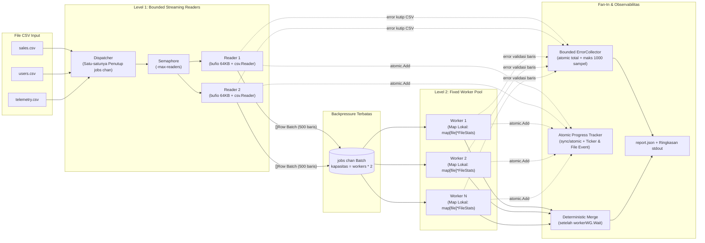

# Pemroses Data CSV Konkuren (`csvproc`)

Aplikasi pemroses file CSV konkuren (*concurrent CSV file processor*) yang *production-grade*, fleksibel terhadap berbagai skema kolom (*schema-agnostic*), dan ditulis menggunakan bahasa **Go (`1.26.1`)** untuk memenuhi **Software Architect Engineer — Technical Coding Assessment (Test Case 1: Concurrent Data Processing)**.

---

## Gambaran Umum (Overview)

`csvproc` membaca dan memproses banyak file CSV sekaligus (dengan skema/nama kolom apa pun) secara *streaming* menggunakan arsitektur **Pipeline Konkurensi Dua Tingkat (Two-Level Bounded Concurrency Pipeline)**:

1. **Membaca Banyak File CSV Secara Simultan (*Reads multiple CSV files simultaneously*)**:
   - Setiap file dibaca baris demi baris secara *streaming* (`bufio.Reader` 64 KB + `encoding/csv`) tanpa pernah memuat seluruh isi file ke dalam RAM.
   - Jumlah file yang dibuka bersamaan dibatasi oleh semaphore yang *context-aware* (`-max-readers`) untuk mencegah error sistem operasi `too many open files` (`EMFILE`).
2. **Memproses Data dengan Pola Worker Pool (*Processes data with worker pool pattern*)**:
   - Sejumlah tetap $N$ *worker goroutines* (`-workers`, default sejumlah core CPU) mengambil paket baris (`Batch` berisi 500 baris) dari *buffered channel* (`jobs`) yang memberikan efek *backpressure* alami.
   - Setiap worker memperbarui statistik di memori lokal miliknya sendiri (**tanpa `sync.Mutex` di jalur utama / *hot path***), kemudian digabungkan (*merge*) satu kali di akhir secara deterministik setelah seluruh worker selesai.
3. **Menangani Error dengan Aman (*Handles errors gracefully*)**:
   - **Error Tingkat Baris (*Row-Level*):** Baris CSV yang rusak (tanda kutip salah, jumlah kolom tidak sesuai header, atau baris kosong) dicatat ke dalam `ErrorCollector` yang dibatasi kapasitas sampelnya (*bounded*, default 1.000 sampel pertama agar jutaan baris rusak tidak menyebabkan *Out of Memory*), sementara baris berikutnya **tetap lanjut diproses**.
   - **Error Tingkat File (*File-Level*):** File yang kosong atau gagal dibuka dicatat gagal pada laporan file tersebut, sementara file CSV lainnya **tetap lanjut diproses**.
   - **Ketahanan Proses (*Panic Recovery & Graceful Shutdown*):** Dilengkapi `recover()` di setiap worker/reader agar *panic* tak terduga tidak mematikan aplikasi, serta menangani sinyal `SIGINT` (`Ctrl+C`) / `SIGTERM` untuk menghentikan pipeline dengan bersih dan tetap menghasilkan laporan parsial (`"partial": true`).
4. **Pelacakan Progress Real-Time (`0.0% - 100.0%`) (*Provides progress tracking*)**:
   - Menggunakan counter `sync/atomic` (`atomic.Int64`) yang *lock-free* serta goroutine pelapor hibrida (**Time-Driven `time.Ticker`** + **Event-Driven saat file selesai**) yang menampilkan persentase byte (`bytesRead / bytesTotal` melalui `os.Stat` tanpa membebani RAM), jumlah file selesai, jumlah baris, dan kecepatan (`rows/s`) ke `stderr`.

> **Catatan terkait General Deliverables pada Dokumen Soal PDF:**
> Poin *Database schema/migration files* dan *API documentation (Swagger/OpenAPI)* tercantum pada bagian *General Deliverables* dokumen soal karena bagian tersebut ditulis secara umum untuk mencakup *Test Case 2: REST API Development* serta Bagian 2 & 3. Karena *Test Case 1* ini adalah aplikasi pemrosesan file konkuren berbasis CLI (tanpa server HTTP maupun database), maka Swagger dan migrasi database tidak digunakan pada proyek ini.

---

## Cara Menjalankan (Quick Start)

### 1. Menjalankan dengan Data Contoh Bawaan (`testdata/` — 14.350 Baris)

```bash
cd test-case-1-csvproc

# Menjalankan pemrosesan pada folder testdata/ (7 file CSV dengan 5 skema berbeda + contoh error baris & file)
make run
```

### 2. Menjalankan Stress Test Dataset Besar (12 Juta Baris) & Demo Live Progress

Untuk melihat pergerakan *progress tracking* `0.0% - 100.0%` mengalir secara *real-time* setiap `200ms`:

```bash
# 1. Generate 12 file CSV x 1.000.000 baris (= 12.000.000 baris total, 3 skema berbeda, 1% baris rusak)
make gendata

# 2. Proses seluruh 12 juta baris dengan 4 worker dan interval progress 200ms
make run-large
```

Contoh output asli `make run-large` pada Apple M1:

```text
[progress]  11.1% | files=0/12 | read=1625975 ok=1602438 err=16062 | rate=8077486 rows/s | elapsed=200ms
[progress]  22.2% | files=0/12 | read=3255007 ok=3216733 err=32267 | rate=8120258 rows/s | elapsed=400ms
[progress]  26.5% | files=1/12 | read=3883310 ok=3840056 err=38444 | rate=8139317 rows/s | elapsed=477ms
[progress]  27.1% | files=2/12 | read=3971683 ok=3927143 err=39357 | rate=8128707 rows/s | elapsed=488ms
[progress]  27.7% | files=3/12 | read=4043525 ok=3997941 err=40059 | rate=8109831 rows/s | elapsed=498ms
[progress]  28.1% | files=4/12 | read=4090510 ok=4042994 err=40506 | rate=8084338 rows/s | elapsed=505ms
...
[progress]  67.6% | files=8/12 | read=8178817 ok=8091629 err=81371 | rate=6892721 rows/s | elapsed=1.186s
[progress]  88.3% | files=8/12 | read=10618152 ok=10507243 err=105757 | rate=6631887 rows/s | elapsed=1.6s
[done]     100.0% | files=12/12 | read=12000000 ok=11880078 err=119922 | rate=6497319 rows/s | elapsed=1.847s
```

### 3. Menjalankan Menggunakan Docker / Docker Compose

```bash
# Build dan jalankan via Docker Compose (hasil laporan ditulis ke ./output/report.json)
docker compose up --build

# Atau build dan jalankan langsung dengan perintah docker
make docker-build
docker run --rm -v "$(pwd)/output:/app/output" csvproc:latest \
  -input /app/testdata -workers 4 -output /app/output/report.json
```

---

## Daftar Argumen / Flag CLI

| Flag | Nilai Default | Penjelasan |
|---|---|---|
| `-input` | `""` | Path direktori yang berisi file `*.csv` (atau path ke satu file CSV) |
| `-file` | `""` | Path file CSV spesifik (dapat diulang atau dipisahkan dengan koma) |
| `-workers` | `runtime.NumCPU()` | Jumlah goroutine worker pada *worker pool* |
| `-batch-size` | `500` | Jumlah baris CSV per satu kali pengiriman ke channel (`1..100000`) |
| `-max-readers` | `8` | Batas maksimum file CSV yang boleh dibuka secara bersamaan |
| `-max-errors` | `1000` | Batas maksimum sampel pesan error baris yang disimpan di memori |
| `-progress-interval` | `500ms` | Interval waktu pencetakan progress ke `stderr` (`0` untuk menonaktifkan) |
| `-output` | `report.json` | Path file output laporan JSON |

---

## Struktur Proyek (Code Organization)

```text
test-case-1-csvproc/
├── cmd/csvproc/
│   ├── main.go               # Entrypoint CLI, parsing flag, dan signal handling (SIGINT/SIGTERM)
│   └── main_test.go          # Unit test untuk alur CLI dan partial report
├── internal/
│   ├── processor/
│   │   ├── pool.go           # Orkestrasi worker pool, semaphore reader, dan proses merge akhir
│   │   ├── reader.go         # Streaming CSV reader (bufio 64KB + byteCounterReader + batching)
│   │   ├── stats.go          # Validasi baris dan perhitungan statistik per kolom
│   │   ├── errors.go         # Custom error types & thread-safe bounded ErrorCollector
│   │   ├── processor_test.go # Unit test, determinism test, semaphore test, cancel & goleak test
│   │   └── benchmark_test.go # Benchmark matriks jumlah worker vs ukuran batch (-benchmem)
│   ├── progress/
│   │   ├── tracker.go        # Atomic progress counters & hybrid ticker/event reporter
│   │   └── tracker_test.go   # Unit test konkurensi tracker & reporter
│   └── report/
│       ├── report.go         # Pembuat laporan JSON atomik (temp file + rename) & ringkasan stdout
│       └── report_test.go    # Unit test pembuat laporan
├── tools/gendata/
│   └── main.go               # Generator dataset CSV multi-skema untuk pengujian beban besar
├── testdata/                 # File CSV contoh untuk pengujian otomatis & demo cepat
├── Dockerfile                # Multi-stage Dockerfile (non-root user)
├── docker-compose.yml        # Konfigurasi Docker Compose
└── Makefile                  # Target otomatisasi build, test, race, cover, bench, dan run
```

---

## Arsitektur & Desain Konkurensi



### Keputusan Arsitektural Utama

1. **Pemrosesan Fleksibel Tanpa Hardcode Kolom (*Schema-Agnostic*)**:
   - Setiap *Reader* membaca baris pertama dari file CSV sebagai daftar nama kolom (`FileMeta.Header`), lalu mengirimkan baris-baris berikutnya dalam bentuk `Batch` ke *Worker*.
   - *Worker* memvalidasi struktur baris (apakah jumlah kolom sama dengan header file tersebut, dan apakah baris tidak kosong), lalu menghitung statistik untuk setiap kolom secara otomatis (`non_empty`, `empty`, `numeric_count`, `min`, `max`, serta penjumlahan bilangan bulat presisi `int_count` & `int_sum`).
   - Dengan pendekatan ini, satu kali eksekusi program dapat memproses puluhan file CSV yang masing-masing memiliki jumlah dan nama kolom yang berbeda-beda.
2. **Pengiriman Berbasis Batch (`Batch` 500 Baris vs 1 Baris per Kirim)**:
   - Setiap pengiriman data lewat channel Go (`jobs <- data`) membutuhkan penguncian internal (`hchan.lock`). Mengelompokkan `500` baris ke dalam satu `Batch` memangkas biaya sinkronisasi channel hingga **500 kali lipat** dan meningkatkan *CPU cache locality*.
3. **State Lokal per Worker + Merge di Akhir (Nol Kontensi Mutex)**:
   - Jika semua worker berbagi satu `map[string]*FileStats` yang sama menggunakan `sync.Mutex`, maka para worker akan saling mengantre di setiap baris (*lock contention*).
   - Sebagai solusinya, setiap worker menyimpan hasil perhitungannya di `map[string]*FileStats` miliknya sendiri. Setelah seluruh worker selesai (`workerWG.Wait()`), barulah goroutine utama menggabungkan (`Merge`) semua map tersebut satu kali. Karena penjumlahan integer (`int64`) dan operasi `min`/`max` bersifat asosiatif dan komutatif, hasil akhirnya **100% deterministik** meskipun dijalankan dengan 1, 4, atau 16 worker.
4. **Aturan Kepemilikan Channel Tunggal (*Single Channel Owner*) & Bebas *Goroutine Leak***:
   - Hanya koordinator producer (`dispatchReaders`) yang menutup channel `jobs`, dan itu dilakukan melalui `defer close(jobs)` **setelah** `readerWG.Wait()` memastikan seluruh goroutine reader telah selesai. Hal ini membuat bug `panic: send on closed channel` mustahil terjadi.
   - Seluruh operasi yang dapat mem-blokir (`sem <- struct{}{}`, `jobs <- batch`, `<-jobs`) selalu dibungkus dengan `select` pada `<-ctx.Done()`, dan diverifikasi bebas bocor menggunakan `go.uber.org/goleak`.

---

## Manajemen Memori (Memory Management)

Pemakaian memori (RAM) aplikasi ini dibatasi secara ketat ($O(1)$) dan **tidak bergantung pada ukuran total file maupun jumlah total file**:

$$\text{Estimasi Puncak RAM} \approx (\text{Workers} \times 2 \times \text{BatchSize} \times \text{UkuranBaris}) + \text{MaxReaders} \times (64\text{ KB} + \text{BatchSize} \times \text{UkuranBaris}) + (\text{MaxErrors} \times \text{UkuranError})$$

- **Streaming I/O**: File dibaca menggunakan `bufio.NewReaderSize(64 KB)`. Seluruh file tidak pernah dimuat sekaligus ke memori.
- **Persentase Byte Tanpa Beban RAM**: Ukuran total byte seluruh file diambil di awal menggunakan `os.Stat()` (hanya membaca metadata filesystem secara instan tanpa membaca isi file), lalu dibandingkan dengan jumlah byte yang melewati `byteCounterReader` setiap potongan 64 KB.
- **Alokasi Slice Batch Baru**: Setiap kali *Reader* mengirim `Batch` ke channel `jobs`, *Reader* mengalokasikan slice baru (`make([]Row, 0, batchSize)`) sehingga *Worker* memiliki penuh slice lama tanpa risiko *data race* akibat *slice aliasing*.
- **Pembatasan Sampel Error**: `ErrorCollector` membatasi penyimpanan detail error di memori maksimal sebanyak `-max-errors` (default `1000` sampel), sementara jumlah total error tetap dihitung penuh menggunakan `atomic.Int64`.

---

## Alasan Pemilihan Teknologi

- **Go `1.26.1` Standard Library (`encoding/csv`, `bufio`, `sync`, `sync/atomic`, `context`, `os/signal`)**: Menyediakan seluruh primitif konkurensi, streaming I/O, dan operasi atomik berperforma tinggi tanpa memerlukan dependensi pihak ketiga saat *runtime*.
- **`go.uber.org/goleak` (Khusus Pengujian / Test-Only)**: Digunakan pada `TestMain` di seluruh package untuk membuktikan secara otomatis bahwa tidak ada goroutine yang tertinggal (*leaked*) baik pada eksekusi normal maupun saat dibatalkan di tengah jalan.
- **Multi-stage Alpine Docker Image**: Menghasilkan binary statis (`CGO_ENABLED=0`) yang ringan dan dijalankan menggunakan akun non-root (`UID 10001`) demi keamanan kontainer.

---

## Strategi Pengujian & Laporan Test Coverage

Jalankan seluruh pengujian otomatis dengan perintah berikut:

```bash
make race    # Menjalankan go test -race -count=3 ./...
make cover   # Menghasilkan coverage.out dan laporan visual coverage.html
```

### Rincian Test Coverage (`92.3%` Total Statements)

| Package | Coverage | Cakupan Pengujian |
|---|---|---|
| `internal/progress` | **98.0%** | Update counter atomik secara konkuren, kalkulasi persentase byte & kecepatan, *event-driven* + *time-driven* reporter, fungsi `stop()` yang *idempotent*, pembatalan `context` (`goleak`) |
| `internal/processor` | **95.4%** | Statistik kolom & *integer overflow*, validasi baris, `ErrorCollector` terbatas di bawah beban konkuren, multi-file berbeda skema, matriks determinisme (`workers 1/4/16` × `readers 1/3/5` × `batch 1/13/500`), batas semaphore `MaxReaders`, pembatalan di tengah proses & saat antre slot (`goleak`), serta *panic recovery* |
| `cmd/csvproc` | **85.7%** | Pencarian file di direktori, flag `-file` tunggal & berulang, deduplikasi file, penulisan laporan parsial saat di-cancel (`SIGINT`), validasi argumen tidak valid |
| `internal/report` | **80.0%** | Perhitungan metrik ringkasan, penulisan file JSON atomik (*temp file + rename*), format output terminal untuk status selesai maupun parsial |
| **Total** | **92.3%** | Seluruh pengujian lulus `go test -race -count=3 ./...` dan `goleak.VerifyTestMain` |

---

## Hasil Benchmark Performa (Data Pengukuran Asli)

Diukur pada **Apple M1 (`darwin/arm64`, 8 core)** memproses **8 file CSV × 5.000 baris (40.000 baris / 1,17 MB per operasi)** melalui perintah `make bench`:

```text
goos: darwin
goarch: arm64
pkg: csvproc/internal/processor
cpu: Apple M1
BenchmarkPipeline/workers=1/batch=50-8            86    11741236 ns/op     99.34 MB/s   13000565 B/op   321129 allocs/op
BenchmarkPipeline/workers=1/batch=500-8           98    11918412 ns/op     97.86 MB/s   12994294 B/op   320410 allocs/op
BenchmarkPipeline/workers=1/batch=2000-8          94    12751585 ns/op     91.47 MB/s   13649346 B/op   320352 allocs/op
BenchmarkPipeline/workers=4/batch=50-8           169     7407411 ns/op    157.46 MB/s   13016643 B/op   321333 allocs/op
BenchmarkPipeline/workers=4/batch=500-8          183     6476416 ns/op    180.10 MB/s   13009068 B/op   320597 allocs/op
BenchmarkPipeline/workers=4/batch=2000-8         192     6538325 ns/op    178.39 MB/s   13657462 B/op   320452 allocs/op
BenchmarkPipeline/workers=8/batch=50-8           154     7014794 ns/op    166.27 MB/s   13038471 B/op   321604 allocs/op
BenchmarkPipeline/workers=8/batch=500-8          194     6230226 ns/op    187.21 MB/s   13021289 B/op   320746 allocs/op
BenchmarkPipeline/workers=8/batch=2000-8         200     6422667 ns/op    181.60 MB/s   13661255 B/op   320494 allocs/op
```

**Kesimpulan Benchmark:**
- Meningkatkan jumlah worker dari `1` ke `8` (`batch=500`) menggandakan kecepatan dari **97,86 MB/s (~3,35 juta baris/detik)** menjadi **187,21 MB/s (~6,42 juta baris/detik)** berkat absennya kontensi mutex pada worker.
- Ukuran `batch=500` memberikan performa paling optimal dibandingkan `batch=50` (terlalu sering mengakses lock channel) maupun `batch=2000` (alokasi memori per batch lebih besar).

---

## Keterbatasan Saat Ini & Pengembangan ke Depan (Known Limitations & Future Improvements)

1. **Satu Baris Kutip Tidak Tertutup pada File Raksasa**: Standar CSV RFC 4180 mengizinkan nilai di dalam tanda kutip mencakup banyak baris. Jika ada tanda kutip pembuka `"` yang tidak pernah ditutup di awal file berukuran puluhan GB, `encoding/csv` akan terus membaca hingga EOF sebagai satu field. *Pengembangan ke depan*: membungkus `io.Reader` dengan pembatas ukuran byte maksimum per baris.
2. **Satu File Tunggal Berukuran Raksasa vs Banyak File**: Karena satu aliran file CSV dibaca secara sekuensial oleh satu goroutine reader (sementara batch-nya tetap diproses paralel oleh banyak worker), skenario 1 file tunggal berukuran 50 GB akan dibatasi oleh kecepatan baca 1 reader tersebut. *Pengembangan ke depan*: memecah pembacaan satu file besar menggunakan *byte-offset chunking* (`io.SectionReader`) yang disejajarkan pada batas karakter newline `\n`.
3. **Deduplikasi Baris Lintas File**: Mendeteksi duplikasi ID baris antar-file membutuhkan struktur penyimpanan bersama (seperti *sharded map* atau *Bloom filter*) yang memiliki *trade-off* penambahan memori sebesar $O(K)$ jumlah ID unik.
4. **Checkpoint & Resume**: Menyimpan daftar file dan offset yang telah selesai ke penyimpanan lokal agar pemrosesan batch skala besar yang terputus dapat dilanjutkan kembali tanpa mengulang dari awal.

---

## Penggunaan AI & Kepemilikan Rekayasa (AI Usage & Engineering Ownership)

- **Pemanfaatan AI**: Digunakan untuk mempercepat pembuatan kerangka CLI flag, variasi kasus uji *table-driven test*, dan skrip generator dataset CSV.
- **Keputusan Arsitektur & Verifikasi yang Dikendalikan Penuh**:
  - Menentukan desain pemroses CSV yang fleksibel (*schema-agnostic*) agar tidak terjadi *over-engineering* pada satu skema bisnis tertentu dan dapat memproses file CSV apa pun.
  - Merancang kepemilikan channel tunggal (*single producer closer*), pembatasan *file descriptor* dengan semaphore `-max-readers`, agregasi lokal per worker tanpa mutex, serta pelacakan persentase byte *streaming* `0.0% - 100.0%`.
  - Memverifikasi seluruh jaminan konkurensi menggunakan `go test -race -count=3 ./...` dan `go.uber.org/goleak`.
