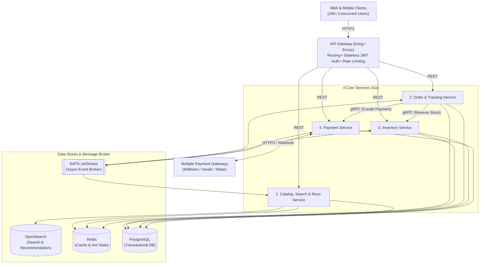
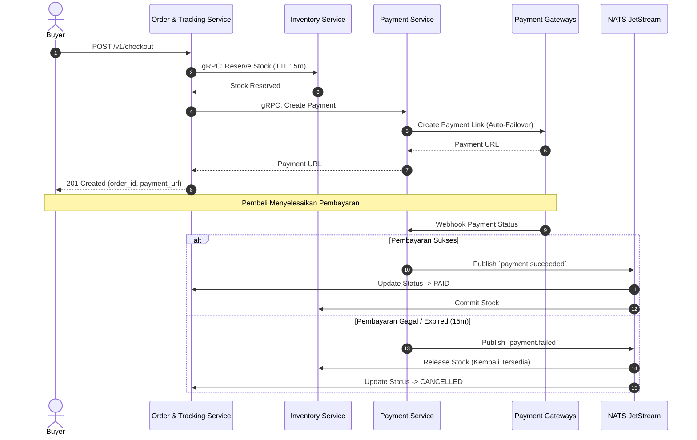
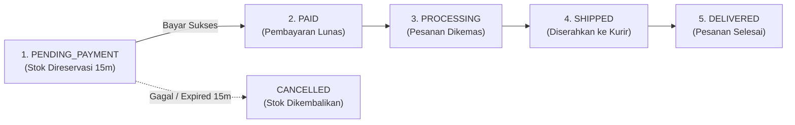
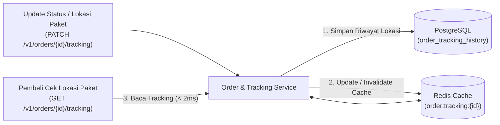

# E-Commerce Platform Architecture Design

Dokumen ini menyajikan rancangan arsitektur sistem e-commerce yang dirancang untuk memenuhi lima spesifikasi utama: menangani **10.000+ pengguna aktif bersamaan (*concurrent users*)**, mendukung **banyak *payment gateway***, **manajemen inventaris *real-time*** bebas *overselling*, **pemrosesan dan pelacakan pesanan (*order processing & tracking*)**, serta **mesin pencarian dan rekomendasi produk**.

---

## Daftar Isi
1. [Estimasi Kapasitas Dasar (10k+ Concurrent Users)](#1-estimasi-kapasitas-dasar-10k-concurrent-users)
2. [High-Level Architecture & Data Flow](#2-high-level-architecture--data-flow)
3. [Technology Stack Recommendations](#3-technology-stack-recommendations)
4. [Database Schema Design](#4-database-schema-design)
5. [API Specification Outline](#5-api-specification-outline)
6. [Scalability, Reliability & Security Considerations](#6-scalability-reliability--security-considerations)

---

## 1. Estimasi Kapasitas Dasar (10k+ Concurrent Users)

Dengan asumsi **10.000 pengguna aktif bersamaan** dan jeda interaksi rata-rata (*think time*) 3–5 detik per pengguna, sistem menerima beban sekitar **2.000 – 3.000 Request Per Second (RPS)** pada kondisi normal, dan meningkat hingga **5.000+ RPS** pada momen promo puncak (*Flash Sale*):

| Jalur Trafik (*Funnel*) | Proporsi Normal | Estimasi Beban Normal | Estimasi Puncak (*Flash Sale*) | Layanan yang Menangani |
| :--- | :--- | :--- | :--- | :--- |
| **Read Funnel** (*Browse, Search, Recommendation, Order Tracking*) | ~85% – 90% | ~1.800 – 2.500 RPS | ~4.000+ RPS | API Gateway, Catalog/Search & Reco Service, Order & Tracking Service (Cache) |
| **Write Funnel** (*Cart, Checkout, Stock Reservation, Payment*) | ~10% – 15% | ~200 – 400 RPS | ~1.000+ RPS | API Gateway, Order & Tracking Service, Inventory Service, Payment Service |

---

## 2. High-Level Architecture & Data Flow

### 2.1 Diagram Arsitektur Utama



### 2.2 Dekomposisi Sistem & Batas Layanan (*Service Boundaries*)

Sistem dibagi menjadi **API Gateway** di lapisan depan dan **4 Core Services** yang dipetakan langsung terhadap kebutuhan fungsional dan karakteristik beban kerja:

| Komponen | Tanggung Jawab Utama | Kepemilikan Data (*Data Ownership*) |
| :--- | :--- | :--- |
| **0. API Gateway** | Pintu masuk tunggal (*routing*), terminasi TLS, verifikasi token **JWT (RS256)** secara *stateless* (`< 1ms` tanpa query DB), dan *rate limiting* berbasis Redis per-IP / per-`user_id`. | Redis (`ratelimit:*`) |
| **1. Catalog, Search & Reco Service** | Menyajikan katalog produk, pencarian *full-text* & filter faset via **OpenSearch**, serta rekomendasi produk (*More-Like-This*, *Frequently Bought Together*, dan *Trending Products*). | PostgreSQL (`categories`, `products`, `product_cooccurrences`), OpenSearch (`products_index`), Redis (`catalog:*`, `reco:*`) |
| **2. Order & Tracking Service** | Mengelola autentikasi pelanggan (`users`), keranjang belanja (*cart*), orkestrasi **Checkout Saga**, pemrosesan status pesanan (*Order Processing*), serta **pelacakan pengiriman pesanan (*Order Tracking*)**. | PostgreSQL (`users`, `shipping_addresses`, `orders`, `order_items`, `order_tracking_history`, `outbox_events`), Redis (`cart:*`, `order:tracking:*`) |
| **3. Inventory Service** | Menjaga konsistensi stok *real-time*, melakukan **reservasi stok atomik berbatas waktu (TTL 15 menit)** saat checkout, pemotongan stok permanen (`COMMITTED`) saat lunas, dan pelepasan stok otomatis (`RELEASED`/`EXPIRED`) bila batal. | PostgreSQL (`inventory`, `inventory_reservations`, `outbox_events`), Redis (`flashsale:stock:*` khusus SKU *Flash Sale*) |
| **4. Payment Service** | Mengisolasi kepatuhan **PCI-DSS**, abstraksi *multi-payment gateway* (**Adapter Pattern**: Midtrans, Xendit, Stripe), *automatic failover* antar gateway, dan verifikasi webhook HMAC secara *idempotent*. | PostgreSQL (`payments`, `payment_webhook_logs`, `outbox_events`) |

> **Aturan Komunikasi & Isolasi Data**: Setiap service hanya mengakses tabel/skema miliknya sendiri (*no cross-service database join*). Komunikasi sinkron kritikal saat *checkout* menggunakan **gRPC**, sedangkan propagasi status pembayaran dan pembaruan stok menggunakan event asinkron melalui **NATS JetStream** dengan pola **Transactional Outbox**.
>
> **Strategi Deployment Pragmatis (*Evolutionary Architecture*)**: Karena ke-4 domain di atas memiliki batas modul dan skema logis yang tegas, sistem dapat di-*deploy* secara fleksibel sesuai kematangan tim—mulai dari *Modular Monolith* untuk efisiensi operasional awal, hingga **4 layanan independen penuh** agar setiap domain dapat di-*scale out* secara terpisah saat beban mencapai 10.000+ *concurrent users*.

---

### 2.3 Alur Checkout, Reservasi Stok, & Payment Saga (*Orchestration + Compensation*)



### 2.4 Alur Pemrosesan Pesanan (*Order Processing Flow*)

Diagram berikut menjelaskan tahapan perubahan status pesanan mulai dari *checkout* hingga pesanan selesai (atau dibatalkan):



### 2.5 Alur Pelacakan Pesanan (*Order Tracking Flow*)

Diagram berikut menjelaskan bagaimana pembaruan lokasi/status pengiriman dicatat dan bagaimana pembeli melacak pesanan secara *real-time* tanpa membebani database utama:



---

## 3. Technology Stack Recommendations

| Layer | Teknologi | Fungsi & Alasan Singkat |
| :--- | :--- | :--- |
| **API Gateway** | **Kong / Envoy** | Pintu masuk tunggal yang menangani routing, validasi JWT RS256 secara *stateless*, dan *rate limiting* berbasis Redis sebelum trafik masuk ke layanan inti. |
| **Backend Runtime** | **Go (Golang)** | Konkurensi tinggi berbasis *goroutine* dengan jejak memori sangat kecil dan waktu *cold-start* instan saat *Horizontal Pod Autoscaling (HPA)* menghadapi lonjakan 10k+ user. |
| **Communication** | **REST (External) & gRPC (Internal Sync)** | REST/JSON untuk integrasi klien web/mobile dan webhook; gRPC (Protobuf over HTTP/2) untuk komunikasi sinkron berlatensi rendah antar-service (`Order <-> Inventory`, `Order <-> Payment`). |
| **Async Event Broker** | **NATS JetStream** | Menangani *event streaming* asinkron (`payment.succeeded`, `stock.updated`), *at-least-once delivery*, *retry backoff*, dan deduplikasi pesan dengan beban operasional jauh lebih ringan dibanding cluster Kafka penuh. |
| **Transactional DB** | **PostgreSQL 16** | Menjamin transaksi **ACID** dan *row-level locking* untuk konsistensi order, stok inventaris, dan pembayaran, didukung *connection pooling* dan *read replicas* untuk skala baca/tulis tinggi. |
| **Cache & Hot State** | **Redis Cluster** | Menyimpan *cache* katalog & pelacakan pesanan (`< 2ms`), keranjang belanja (*cart*), *rate limiter*, serta eksekusi **Lua Script atomik** untuk kuota stok saat *Flash Sale*. |
| **Search & Reco Engine** | **OpenSearch** | Menangani *full-text search* (toleransi salah ketik/sinonim), *faceted filtering* (kategori, harga, rating), dan rekomendasi kemiripan produk (*More-Like-This*) tanpa membebani PostgreSQL. |

---

## 4. Database Schema Design

Setiap *Core Service* memiliki skema logis tersendiri di PostgreSQL. Definisi DDL SQL selengkapnya tersedia pada file [schema.sql](file:///Users/rizkisaifulnizar/Documents/Projects/test-case/test-case-2-ecommerce-architecture/schema.sql).

### Ringkasan Tabel Inti & Pencegahan *Race Condition*

1. **Inventory Domain (`inventory` & `inventory_reservations`)**:
   * Menggunakan `CHECK (available_qty >= 0 AND reserved_qty >= 0)` sebagai jaring pengaman level database agar stok tidak pernah bernilai negatif (*zero overselling*).
   * Setiap *checkout* mencatat baris pada `inventory_reservations` dengan `status = 'PENDING'` dan `expires_at = NOW() + INTERVAL '15 minutes'`.
2. **Order & Tracking Domain (`orders`, `order_items`, `order_tracking_history`)**:
   * Tabel `orders` memiliki kolom `idempotency_key VARCHAR(64) UNIQUE NOT NULL` untuk memastikan klik ganda dari pembeli tidak pernah menghasilkan pesanan duplikat.
   * Tabel `order_tracking_history` mencatat setiap perpindahan status pesanan, nomor resi (*tracking_number*), dan lokasi pengiriman secara kronologis.
3. **Payment Domain (`payments` & `payment_webhook_logs`)**:
   * Menyimpan transaksi lintas gateway (`gateway_name`, `gateway_reference_id`) dan mencatat setiap webhook yang masuk dengan *constraint* `UNIQUE (gateway_name, gateway_event_id)` agar pemrosesan callback bersifat 100% *idempotent*.
4. **Transactional Outbox (`outbox_events`)**:
   * Setiap perubahan state penting disimpan ke tabel `outbox_events` dalam **satu transaksi DB yang sama**, lalu di-publish ke NATS JetStream oleh *background relay worker* (`SELECT ... FOR UPDATE SKIP LOCKED`).

```sql
-- Cuplikan Tabel Inti (DDL lengkap tersedia di schema.sql)

CREATE TABLE inventory (
    sku_id          UUID PRIMARY KEY,
    available_qty   INT NOT NULL DEFAULT 0 CHECK (available_qty >= 0),
    reserved_qty    INT NOT NULL DEFAULT 0 CHECK (reserved_qty >= 0),
    version         BIGINT NOT NULL DEFAULT 1,
    updated_at      TIMESTAMPTZ NOT NULL DEFAULT NOW()
);

CREATE TABLE inventory_reservations (
    reservation_id  UUID PRIMARY KEY,
    order_id        UUID NOT NULL,
    sku_id          UUID NOT NULL REFERENCES inventory(sku_id),
    quantity        INT NOT NULL CHECK (quantity > 0),
    status          VARCHAR(20) NOT NULL DEFAULT 'PENDING', -- PENDING, COMMITTED, RELEASED, EXPIRED
    expires_at      TIMESTAMPTZ NOT NULL,
    created_at      TIMESTAMPTZ NOT NULL DEFAULT NOW(),
    UNIQUE (order_id, sku_id)
);

CREATE TABLE orders (
    order_id        UUID PRIMARY KEY,
    user_id         UUID NOT NULL,
    idempotency_key VARCHAR(64) NOT NULL UNIQUE,
    status          VARCHAR(30) NOT NULL DEFAULT 'PENDING_PAYMENT',
    tracking_number VARCHAR(64),
    total_amount    NUMERIC(15, 2) NOT NULL CHECK (total_amount >= 0),
    currency        CHAR(3) NOT NULL DEFAULT 'IDR',
    created_at      TIMESTAMPTZ NOT NULL DEFAULT NOW(),
    updated_at      TIMESTAMPTZ NOT NULL DEFAULT NOW()
);

CREATE TABLE order_tracking_history (
    tracking_id     BIGSERIAL PRIMARY KEY,
    order_id        UUID NOT NULL REFERENCES orders(order_id) ON DELETE CASCADE,
    status          VARCHAR(30) NOT NULL,
    location        VARCHAR(120),
    description     TEXT NOT NULL,
    created_at      TIMESTAMPTZ NOT NULL DEFAULT NOW()
);

CREATE TABLE payments (
    payment_id           UUID PRIMARY KEY,
    order_id             UUID NOT NULL,
    idempotency_key      VARCHAR(64) NOT NULL UNIQUE,
    gateway_name         VARCHAR(30) NOT NULL, -- MIDTRANS, XENDIT, STRIPE
    gateway_reference_id VARCHAR(128),
    amount               NUMERIC(15, 2) NOT NULL CHECK (amount >= 0),
    status               VARCHAR(20) NOT NULL DEFAULT 'PENDING', -- PENDING, SUCCEEDED, FAILED, REFUNDED
    payment_url          TEXT,
    created_at           TIMESTAMPTZ NOT NULL DEFAULT NOW(),
    updated_at           TIMESTAMPTZ NOT NULL DEFAULT NOW()
);
```

---

## 5. API Specification Outline

Seluruh endpoint eksternal diakses melalui **API Gateway** menggunakan protokol HTTPS dengan format JSON.

| Domain | Method & Path | Auth | Idempotency | Deskripsi Singkat |
| :--- | :--- | :--- | :--- | :--- |
| **Auth** | `POST /v1/auth/login` | Public | Tidak | Autentikasi pengguna dan menerbitkan pasangan *JWT Access Token* (15m) & *Refresh Token*. |
| **Catalog & Search** | `GET /v1/products/search` | Public | Ya (GET) | Pencarian produk *full-text* dan filter faset (`?q=kopi&category=minuman&sort=price_asc&cursor=...`). |
| **Catalog** | `GET /v1/products/{id}` | Public | Ya (GET) | Mengambil detail produk beserta ketersediaan stok *real-time* dari cache Redis. |
| **Recommendation** | `GET /v1/products/{id}/recommendations` | Public | Ya (GET) | Mengembalikan produk serupa (*OpenSearch More-Like-This*) dan produk yang sering dibeli bersamaan. |
| **Cart** | `PUT /v1/cart/items` | JWT (`Buyer`) | Ya (PUT) | Menambah atau mengubah jumlah SKU di dalam keranjang belanja pengguna (Redis). |
| **Checkout / Order** | `POST /v1/checkout` | JWT (`Buyer`) | **Wajib** (`Idempotency-Key`) | Membuat pesanan, mereservasi stok (TTL 15 menit), dan mengembalikan tautan/token pembayaran. |
| **Order Tracking** | `GET /v1/orders/{id}/tracking` | JWT (`Buyer`) | Ya (GET) | Menampilkan status pesanan terkini, nomor resi, dan kronologi riwayat pengiriman (*tracking history*). |
| **Order Status Update** | `PATCH /v1/orders/{id}/tracking` | JWT (`Admin/System`) | **Wajib** (`Idempotency-Key`) | Memperbarui status pemrosesan/pengiriman pesanan (`PROCESSING`, `SHIPPED`, `IN_TRANSIT`, `DELIVERED`). |
| **Payment Webhook** | `POST /v1/webhooks/payments/{gateway}` | HMAC Signature | **Wajib** (`gateway_event_id`) | Menerima callback status pembayaran dari Midtrans/Xendit/Stripe secara asinkron & idempoten. |

### Contoh Payload Utama

**1. Checkout Request (`POST /v1/checkout`)**
```http
POST /v1/checkout HTTP/1.1
Authorization: Bearer <JWT>
Idempotency-Key: 9b1deb4d-3b7d-4bad-9bdd-2b0d7b3dcb6d
Content-Type: application/json

{
  "shipping_address_id": "d290f1ee-6c54-4b01-90e6-d701748f0851",
  "payment_method": "VIRTUAL_ACCOUNT_BCA",
  "items": [
    { "sku_id": "7c9e6679-7425-40de-944b-e07fc1f90ae7", "quantity": 2 }
  ]
}
```

**2. Checkout Response (`201 Created`)**
```json
{
  "order_id": "550e8400-e29b-41d4-a716-446655440000",
  "status": "PENDING_PAYMENT",
  "total_amount": 150000.00,
  "currency": "IDR",
  "reservation_expires_at": "2026-10-30T10:15:00Z",
  "payment": {
    "payment_id": "a1b2c3d4-e5f6-7890-abcd-ef1234567890",
    "gateway": "MIDTRANS",
    "payment_url": "https://app.midtrans.com/snap/v2/vtweb/..."
  }
}
```

---

## 6. Scalability, Reliability & Security Considerations

### 6.1 Strategi Menangani 10k+ Concurrent Users di Seluruh Layanan

Beban 10.000+ pengguna bersamaan ditangani secara spesifik di setiap lapisan layanan:

1. **API Gateway**:
   * **Stateless JWT Verification & Rate Limiting**: Verifikasi JWT RS256 dilakukan di memori API Gateway (`< 1ms`), sedangkan algoritma *Token Bucket* di Redis membatasi lonjakan trafik per-IP pada endpoint baca dan membatasi ketat endpoint tulis (`POST /v1/checkout` maksimal 5 req/10 detik per `user_id`).
2. **Catalog, Search & Reco Service (Menyerap ~2.000+ Read RPS)**:
   * **Redis Cache-Aside + Singleflight**: Detail produk dan rekomendasi disajikan dari Redis (`< 2ms`). Teknik *request coalescing* (`singleflight`) mencegah *cache stampede* ketika cache produk populer kedaluwarsa bersamaan.
   * **OpenSearch Offloading**: Seluruh pencarian teks dan filter faset dilayani oleh OpenSearch sehingga database utama PostgreSQL tidak terbebani query pencarian.
3. **Order & Tracking Service (Menangani Lonjakan Checkout & Tracking)**:
   * **Short-Lived DB Transactions**: Layanan Order **tidak pernah** memanggil API Payment Gateway di dalam blok transaksi `BEGIN ... COMMIT` PostgreSQL. Transaksi database selesai dalam `< 5ms` agar koneksi database tidak terkunci lama.
   * **Pemisahan Jalur Sinkron vs Asinkron**: Jalur *checkout* sinkron hanya memproses validasi, reservasi stok, dan pembuatan pembayaran (`p95 < 150ms`), sementara pembaruan lanjutan diproses secara asinkron melalui **NATS JetStream**.
   * **Order Tracking Cache**: Saat ribuan pengguna me-*refresh* halaman lacak pesanan secara bersamaan, riwayat status disajikan dari Redis (`order:tracking:{order_id}`) dan hanya di-*invalidate* ketika ada pembaruan status pengiriman.
4. **Inventory Service (Konsistensi Stok Real-Time Tanpa Deadlock)**:
   * **SKU Normal (Atomic SQL Update)**: Menggunakan satu instruksi SQL atomik:
     `UPDATE inventory SET available_qty = available_qty - $qty, reserved_qty = reserved_qty + $qty WHERE sku_id = $sku AND available_qty >= $qty;`
     Untuk pesanan multi-item, daftar `sku_id` selalu diurutkan secara alfabetis sebelum dikunci guna mencegah *deadlock*.
   * **SKU Flash Sale (Selective Redis Lua Pre-Gate)**: Khusus produk promo yang diperebutkan ribuan user di detik yang sama, pengecekan dan pemotongan kuota awal dilakukan di Redis menggunakan skrip Lua atomik (`< 1ms`) sebelum diteruskan ke PostgreSQL.
5. **Payment Service (Isolasi Latensi Pihak Ketiga)**:
   * Panggilan HTTP ke Midtrans/Xendit/Stripe menggunakan *timeout* ketat (3 detik) dan pola **Circuit Breaker** agar perlambatan pada satu payment gateway tidak menghambat goroutine layanan lainnya.

---

### 6.2 Reliability, Error Handling & Fault Tolerance

* **Multi-Payment Gateway Smart Routing & Automatic Failover**:
  * Setiap gateway (Midtrans, Xendit, Stripe) dibungkus dengan **Adapter Interface** yang seragam dan **Circuit Breaker** masing-masing.
  * Jika tingkat kegagalan (*error rate* / *timeout*) pada gateway utama (Midtrans) melewati ambang batas (>20% dalam 30 detik), *Circuit Breaker* terbuka dan pembuatan pembayaran baru otomatis dialihkan ke gateway cadangan (Xendit).
* **Pencegahan Stok Terkunci Selamanya (*Abandoned Checkout TTL*)**:
  * *Background worker* di Inventory Service berjalan setiap 30 detik mencari reservasi berstatus `PENDING` yang melewati `expires_at` (15 menit), mengembalikan `available_qty`, mengubah status menjadi `EXPIRED`, dan mem-publish event pembatalan pesanan.
* **Idempotency & At-Least-Once Event Delivery**:
  * Seluruh consumer **NATS JetStream** dirancang *idempotent* dengan mekanisme *automatic retry backoff* (`NakWithDelay`) serta *Dead-Letter Queue (DLQ)* untuk menangkap pesan yang gagal diproses berulang kali tanpa kehilangan data.
* **High Availability**:
  * Seluruh layanan Go berjalan *stateless* dan di-*scale* secara horizontal (*HPA*), sedangkan PostgreSQL dan Redis dijalankan dalam konfigurasi *Multi-AZ Primary-Standby* dengan *automated failover*.

---

### 6.3 Security & Compliance Considerations

* **Reduksi Ruang Lingkup PCI-DSS (SAQ-A / Tokenization)**:
  * Sistem **tidak pernah** menyimpan atau memproses nomor kartu kredit mentah (*PAN/CVV*). Pembayaran dilakukan melalui *Redirect / Tokenization* milik Payment Gateway sehingga risiko kebocoran data kartu dan ruang lingkup audit PCI-DSS tereduksi secara maksimal.
* **Keamanan Webhook (HMAC Signature & Replay Protection)**:
  * Setiap webhook pembayaran wajib diverifikasi tanda tangan kriptografisnya (`HMAC-SHA256`) serta keunikan `gateway_event_id` untuk menangkal pemalsuan status lunas (*spoofing*) dan *replay attack*.
* **Autentikasi, Otorisasi & Perlindungan Data Pribadi (PII)**:
  * **Stateless JWT (RS256)** diverifikasi di API Gateway, disertai validasi kepemilikan `user_id` pada setiap akses pesanan (*mencegah celah BOLA / IDOR*).
  * Seluruh komunikasi menggunakan **TLS 1.3**, kredensial disimpan di *Secret Manager*, dan data sensitif pengguna (*PII*) dienkripsi pada level penyimpanan (*AES-256*) serta disamarkan (*masked*) pada log aplikasi.
